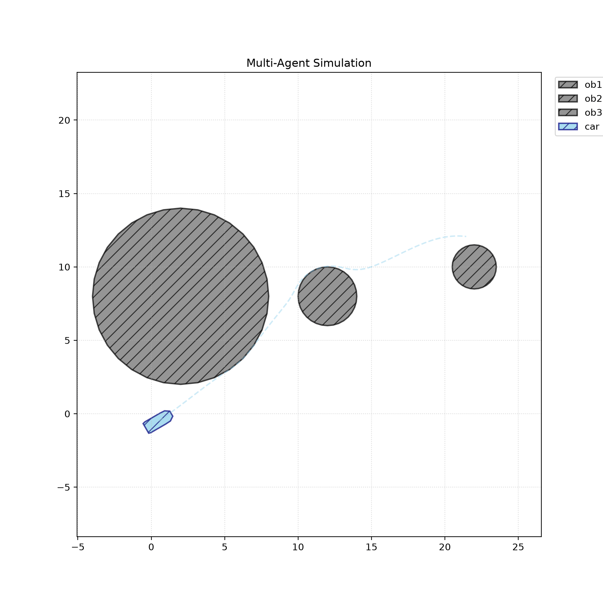

## Ocp2Fatrop

[Fatrop](https://github.com/meco-group/fatrop) is a structure-exploiting discrete optimal control problem (OCP) solver designed for fast numerical optimal control. Inspired by IPOPT, it implements a primal-dual interior-point algorithm and uses generalized Riccati recursion to solve the KKT linear system efficiently at each Newton iteration. If KKT solve time is a bottleneck in your current workflow, switching to Fatrop can deliver significant speedups. However, Fatrop requires multiple-shooting transcription along with a strict ordering of variables and constraints. Setting this up manually in loops is both tedious and error-prone.

**ocp2fatrop** removes this boilerplate by providing a high-level modeling layer for OCPs:

- **Batching & Graph Compression:** Uses CasADi's `map` construct instead of manual Python loops to keep symbolic graphs compact and fast to evaluate.
- **Automated Transcription:** Handles variable ordering, constraint structuring, and transcription into the discrete OCP/NLP behind the scenes, allowing you to focus on problem formulation rather than solver plumbing.

  

## Requirements

- python
- matplotlib
- casadi 3.8.2
- numpy

## Problem

The `Ocp2Fatrop` class supports continuous-time **Bolza-form Optimal Control Problems (OCPs)** defined by the following mathematical program:

$$\min_{x(t), u(t), t_0, t_f} \int_{t_0}^{t_f} L(t, x(t), u(t)) \, dt + E(t_0, t_f, x(t_0), x(t_f))$$

where $t_0$ and $t_f$ are fixed and **not free**.

**Subject to:**

1. **System Dynamics:**

$$
\dot{x}(t) = f(t, x(t), u(t)) \quad \forall t \in [t_0, t_f]
$$

2. **Path Constraints:**

$$h_{\text{lb}} \le h(t, x(t), u(t)) \le h_{\text{ub}}$$

3. **Initial Boundary / Event Constraints:**

$$e_{0,\text{lb}} \le e_0(t_0, x(t_0)) \le e_{0,\text{ub}}$$

4. **Final Boundary / Event Constraints:**

$$e_{f,\text{lb}} \le e_f(t_f, x(t_f)) \le e_{f,\text{ub}}$$

_Note that the event constraints are separated based on the boundary it lies in. This is a hard requirement for FATROP. Periodic constraints on the state cannot be imposed_

### Description of Variables and Functions

The code maps these mathematical elements into CasADi symbolic variables and Python attributes:

#### Dimensions & Horizon

- **`nx`**: Dimension of the state vector $x(t)$.
- **`nu`**: Dimension of the control input vector $u(t)$.
- **`T0`**, **`Tf`**: Nominal initial and final time.

#### Symbolic Variables

- **`t`**: Time symbol (`cs.SX`).
- **`x`**: State vector symbol of size `nx` (`cs.SX`).
- **`u`**: Control vector symbol of size `nu` (`cs.SX`).
- **`t0`**, **`tf`**: Initial and final time symbols.
- **`x0`**, **`xf`**: Initial and final state vector symbols.

These are used to construct various elements of the OCP.

#### Objective & Dynamics Expressions (`set_expressions`)

- **`_L`**: Lagrange term (running cost integrand $L$).
- **`_E`**: Mayer term (terminal cost function $E$).
- **`_f`**: Continuous-time ODE dynamics function $f$.

#### Constraints & Bounds (`set_expressions`)

- **`_h`**, **`_h_lb`**, **`_h_ub`**: Path constraint function $h$ along with its lower ($h_{\text{lb}}$) and upper ($h_{\text{ub}}$) numerical bounds.
- **`_e0`**, **`_e0_lb`**, **`_e0_ub`**: Initial event condition function $e_0$ with its bounds.
- **`_ef`**, **`_ef_lb`,** `_ef_ub`**: Final event condition function $e_f$ with its bounds.

## Multiple shooting

The continuous-time optimal control problem is discretized into a finite-dimensional Nonlinear Program (NLP) using **$N$ intervals** and **$N+1$ grid points**, indexed by $k \in \{1, 2, \dots, N+1\}$.

### 1. Grid and Variable Indexing

- **Time Grid ($t_k$):** $N+1$ collocation/mesh points spanning from $T_0$ to $T_f$.
- **State Vector ($x_k$):** Indexed from $1$ to $N+1$ ($k = 1, \dots, N+1$).
- **Control Input Vector ($u_k$):** Indexed from $1$ to $N$ ($k = 1, \dots, N$), corresponding to the intervals between grid points.

---

### 2. Constraints and Dynamics Formulation

#### System Dynamics (Shooting Constraints)

For each interval $k \in \{1, \dots, N\}$, the transition from state $x_k$ to $x_{k+1}$ is enforced via a shooting/integration map $\phi$ (such as the trapezoidal collocation `trap` or Runge-Kutta `rk4` scheme):

$$x_{k+1} = \phi(t_k, x_k, u_k), \quad k = 1, \dots, N$$

#### Path Constraints

Evaluated across the first $N$ grid points ($k = 1, \dots, N$):

$$h_{\text{lb}} \le h(t_k, x_k, u_k) \le h_{\text{ub}}, \quad k = 1, \dots, N$$

#### Boundary / Event Constraints

- **Initial Constraint ($e_0$):** Evaluated at the first grid point ($k = 1$):

$$e_{0,\text{lb}} \le e_0(t_1, x_1) \le e_{0,\text{ub}}$$

- **Final Constraint ($e_f$):** Evaluated at the final grid point ($k = N+1$):

$$e_{f,\text{lb}} \le e_f(t_{N+1}, x_{N+1}) \le e_{f,\text{ub}}$$

## NLP

To solve the continuous-time optimal control problem numerically, it is transcribed into a finite-dimensional Nonlinear Program (NLP) consisting of structured decision and constraint vectors.

### Decision Vector ($W$)

The decision variable vector stacks all state and control trajectories across the $N$ intervals and $N+1$ grid points:

$$
W=
\begin{bmatrix}
x_1\\
u_1\\
x_2\\
u_2\\
\vdots \\
x_{n}\\
u_{n}\\
x_{n+1}
\end{bmatrix}
$$

Where:

- $x_k$ for $k \in \{1, \dots, N+1\}$ represents the state vector at each grid point.
- $u_k$ for $k \in \{1, \dots, N\}$ represents the control input vector applied over each interval.

---

### Constraint Vector ($G$) and Bounds ($G_{lb}, G_{ub}$)

The constraints are interleaved into a structured vector $G$ along with their respective lower ($G_{lb}$) and upper ($G_{ub}$) bounds:

$$
G=\begin{bmatrix}
r_1\\
h_1\\
e_1\\
r_2\\
h_2\\
\vdots \\
r_{n}\\
h_{n}\\
e_{n+1}
\end{bmatrix},
\quad
G_{lb}=
\begin{bmatrix}
r_{(lb,1)}\\
h_{(lb,1)}\\
e_{(lb,1)}\\
r_{(lb,2)}\\
h_{(lb,2)}\\
\vdots \\
r_{(lb,n)}\\
h_{(lb,n)}\\
e_{(lb,n+1)}
\end{bmatrix},
\quad
G_{ub}=
\begin{bmatrix}
r_{(ub,1)}\\
h_{(ub,1)}\\
e_{(ub,1)}\\
r_{(ub,2)}\\
h_{(ub,2)}\\
\vdots \\
r_{(ub,n)}\\
h_{(ub,n)}\\
e_{(ub,n+1)}
\end{bmatrix}
$$

Where:

- **$r_k$ (Dynamics / Shooting Residuals):** Enforces transition continuity from step $k$ to $k+1$ (e.g., $x_{k+1} - \phi(t_k, x_k, u_k) = 0$), where lower and upper bounds are typically set to zero ($r_{lb} = r_{ub} = 0$).
- **$h_k$ (Path Constraints):** Enforces state-control constraints evaluated at each interval ($h_{\text{lb}} \le h_k \le h_{\text{ub}}$).
- **$e_1$ and $e\_{n+1}$ (Boundary / Event Constraints):** Enforces initial conditions at $k=1$ ($e_1 = e_0$) and final conditions at $k=N+1$ ($e_{n+1} = e_f$).
